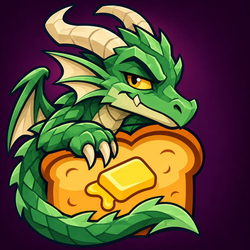
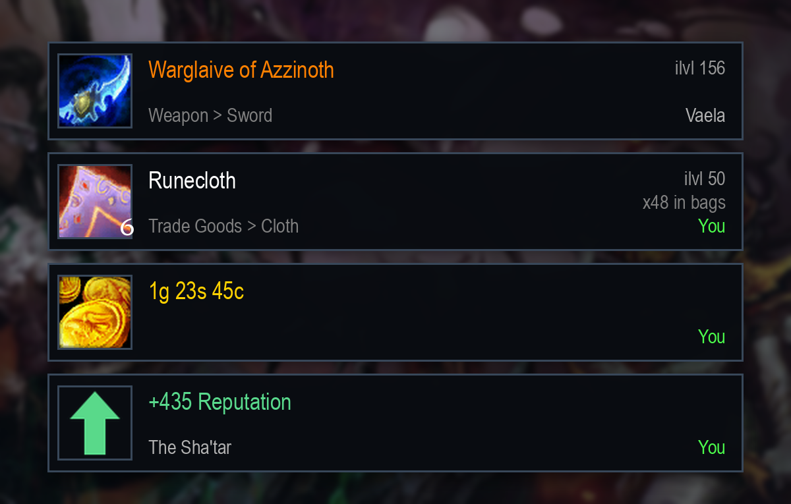
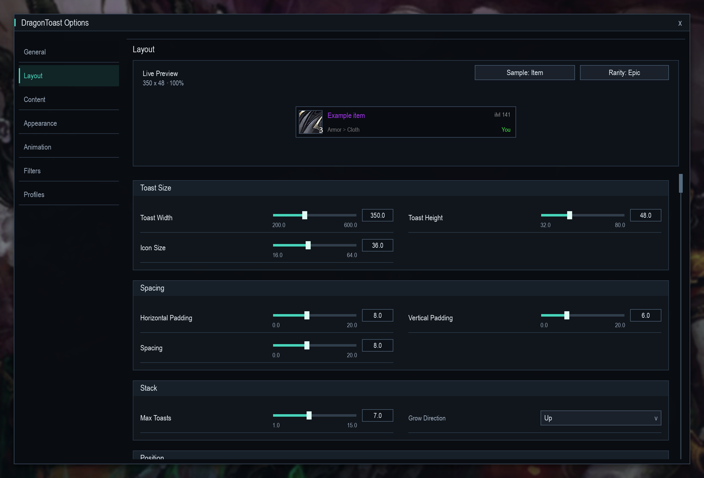

# Dragon Toast

**See what dropped while the group keeps moving.**

[Get it on CurseForge](https://www.curseforge.com/wow/addons/dragon-toast) · [Get it on Wago](https://addons.wago.io/addons/dragon-toast) · [GitHub releases](https://github.com/Xerrion/DragonToast/releases/latest)

An orange item name catches your eye. It’s a Warglaive of Azzinoth, item level 156, and Vaela just looted it.
Hover over the card to inspect it or shift-click to share it in chat. On a cloth run, that same spot can show six pieces
of Runecloth coming in and how many you now have in your bags.

*Offline render of the Modern skin with bag counts enabled. Type `/dt test` to see a card animate in your own UI.*

## Pick what gets your attention

**On a farming run**, repeat drops add to the card that’s already on screen. Turn on **Show Item Count** and you can
see when you’ve collected enough cloth for your next bandage.

**In a raid**, choose the minimum item quality you want to see and whether to include other players’ drops. Give epics
a pulse when they land. If you want the screen clear during a fight, **Defer in Combat** holds new cards until combat
ends.

**While leveling**, watch XP from a string of kills add up on one card. Reputation changes show the faction involved.
Use **Filters** to decide whether gold, currency, honor, and mailbox pickups belong in the stack too.

## Make it fit your UI

Try **Parchment** for a warm, paper-colored backdrop or **Minimal** for a small icon and borderless card. The sample
in `/dt config` stays in view as you change fonts, glow, textures, or spacing. Set the stack to grow upward from
your action bars or downward beside your unit frames. If you run ElvUI, you can use its font and border color here too.

*Offline preview of the Layout page in `/dt config`.*

## Get started

1. Install Dragon Toast with your addon manager. For a manual install, extract both `DragonToast` and `DragonToast_Options` from the release ZIP into your client’s `Interface/AddOns/` folder and reload the UI.
2. In game, type `/dt test` for a sample drop. Type `/dt lock`, drag the anchor where you want your cards, and type
   `/dt lock` again to keep it there.
3. Open `/dt config` and pick a skin under **Appearance**. To see how it handles a busy pull, run `/dt massloot 8`.
   Clear the samples with `/dt clear`.

**Supported clients** include Retail, WoW Forever, TBC Anniversary, and Mists of Pandaria Classic.

## Pair it with Dragon Loot

Dragon Loot handles the loot window and group rolls. Use the two together to see who won a roll in your toast stack.
While the loot window is open, Dragon Loot can keep those same items from popping up a second time.
[Get Dragon Loot](https://github.com/Xerrion/DragonLoot)

More commands and project links

| Command | What it does |
| --- | --- |
| `/dt config` | Open settings. Left-clicking the minimap button also opens them. |
| `/dt lock` | Unlock or lock the movable anchor. |
| `/dt reset` | Return the anchor to its original position. |
| `/dt test` · `/dt testmode` | Show one sample, or toggle a continuous stream while you adjust the stack. |
| `/dt massloot [count]` · `/dt clear` | Preview a burst of drops, or dismiss everything on screen and in the queue. |
| `/dt toggle` · `/dt status` | Enable or disable the addon, or check its current settings. |
| `/dt help` | List all commands. |

For authors, Dragon Toast accepts custom notifications and item suppression requests through local AceEvent messages.
[Integration API and example](AGENTS.md#cross-addon-messaging-api) · [Options preview guide](docs/options-preview.md)

Found a bug or want to help with a translation? Please include your client and addon version when reporting a problem.
[Report an issue](https://github.com/Xerrion/DragonToast/issues) · [Contributing](CONTRIBUTING.md)

Made by [Xerrion](https://github.com/Xerrion). [MIT License](LICENSE) · [GitHub Sponsors](https://github.com/sponsors/Xerrion) · [Ko-fi](https://ko-fi.com/Xerrion). World of Warcraft artwork and icons © Blizzard Entertainment.

